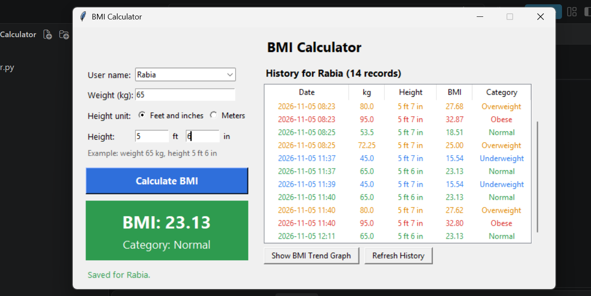
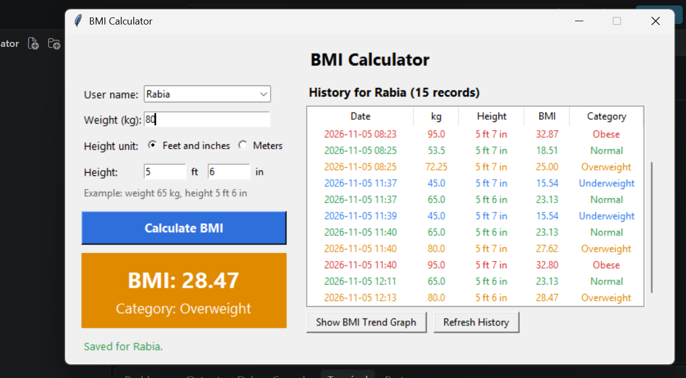
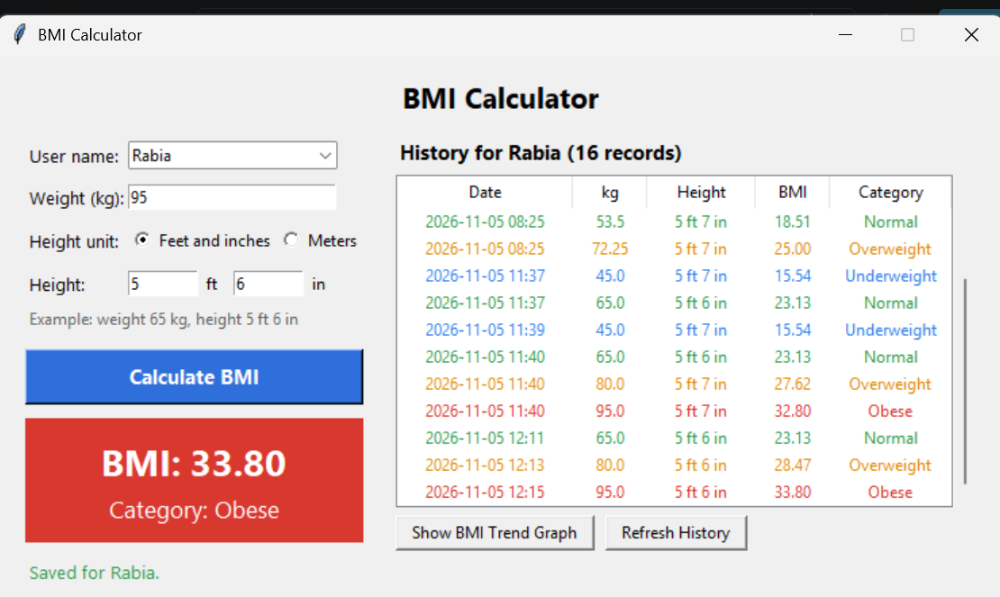
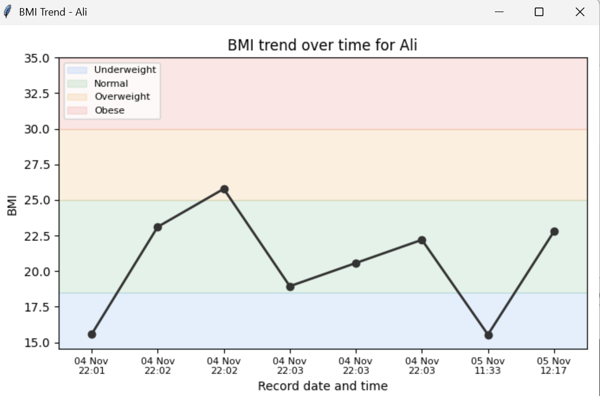
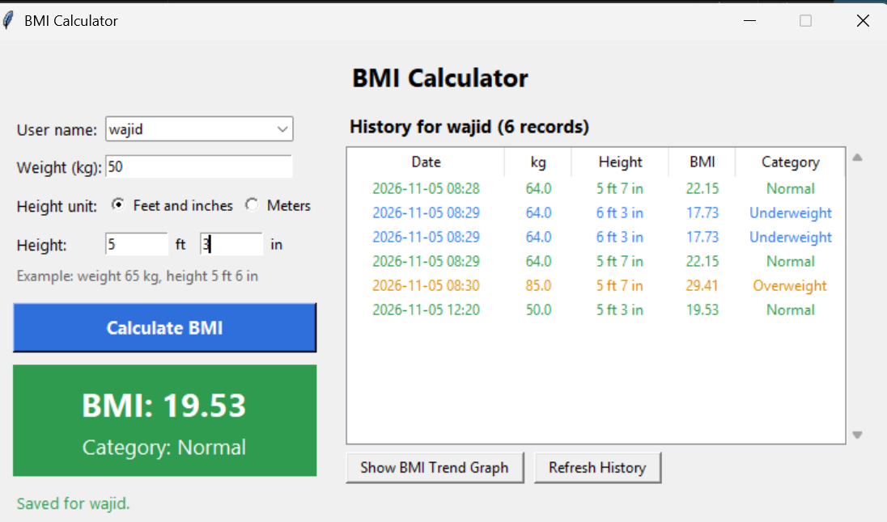

# BMI Calculator (Advanced Tier)

**Name:** Rabia Azam
**Internship:** Oasis Infobyte (OIBSIP)
**Track:** Python Programming
**Task:** Task 2 - BMI Calculator (Advanced)

## About
A desktop application (tkinter GUI) that calculates Body Mass Index (BMI), shows the health category in colour, saves the results for different users in a database, and draws a chart of how a person's BMI changes over time.

## Why This Project?
BMI is a quick number that helps people see if their weight is in a healthy range for their height. Checking it once is easy, but tracking it over weeks or months is what shows real progress. This tool saves every result under a user name, so a person, a family, or a gym can see the history and the trend in one place.

## Features
- GUI window built with **tkinter**, no command line needed
- Labelled input fields for user name, weight (kg) and height, and a **Calculate** button
- **Height unit choice:** feet and inches (for example 5 ft 6 in) or meters (for example 1.70). Feet and inches are converted to meters before the calculation.
- Formula: `BMI = weight (kg) / (height (m) x height (m))`, shown with 2 decimal places
- **Colour-coded result:** Underweight (blue), Normal (green), Overweight (orange), Obese (red)
- **Input validation** with helpful messages inside the window: empty fields, text instead of numbers, zero or negative values, unrealistic values, inches of 12 or more, and height typed in centimetres by mistake
- **Multi-user support:** records are saved under a user name (names are not case sensitive)
- **History table** for the selected user, coloured by category (height is shown in feet and inches)
- **SQLite database** (`bmi_data.db`) stores all records
- **Trend graph** (matplotlib): line chart of the user's BMI over time, with coloured category bands
- **Error handling** for database problems: if the database cannot be read or written, the app shows a message instead of crashing, and the calculator still works

## BMI Categories
| BMI | Category |
|---|---|
| Below 18.5 | Underweight |
| 18.5 to 24.9 | Normal |
| 25 to 29.9 | Overweight |
| 30 and above | Obese |

## Tech Stack
Python 3, tkinter, sqlite3 (both included with Python), matplotlib

## Installation and Run
```cmd
pip install matplotlib
python bmi_calculator.py
```
If `matplotlib` is not installed, the calculator and history still work. Only the graph needs it.

## How to Use
1. Type or choose a **user name**
2. Enter **weight in kg**, choose the **height unit** (feet and inches, or meters), and enter the height (for example 65 kg and 5 ft 6 in, or 65 kg and 1.70 m)
3. Click **Calculate BMI** (or press Enter). The result is shown and saved.
4. Choose a name from the drop-down list to see that user's history
5. Click **Show BMI Trend Graph** to see the chart

## How It Works
1. `validate_weight()`, `validate_height()` (meters) and `validate_height_feet()` (feet and inches) check the input and raise a clear error message if it is wrong. Feet and inches are converted with `1 inch = 0.0254 m`.
2. `calculate_bmi()` and `classify_bmi()` give the BMI value and its category.
3. `BMIDatabase` saves and loads records using SQLite. Queries use `?` placeholders, so user input cannot damage the database.
4. `BMIApp` builds the window and connects everything. The graph opens in its own window.

## Privacy and Health Note
- All data stays on your computer in the file `bmi_data.db`. Nothing is sent over the internet.
- BMI is a general screening number. It does not measure body fat and is not medical advice. Please talk to a doctor about your health.

## Files
- `bmi_calculator.py`: the application (main submission)
- `README.md`: this file
- `screenshots/`: screenshots of the application

## Screenshots

### Main window (Normal result)


### Colour-coded result (Overweight or Obese)


### History of different users


### BMI trend graph


### Error handling


## Demo Video
https://www.linkedin.com/feed/update/urn:li:activity:7524000498471821312/