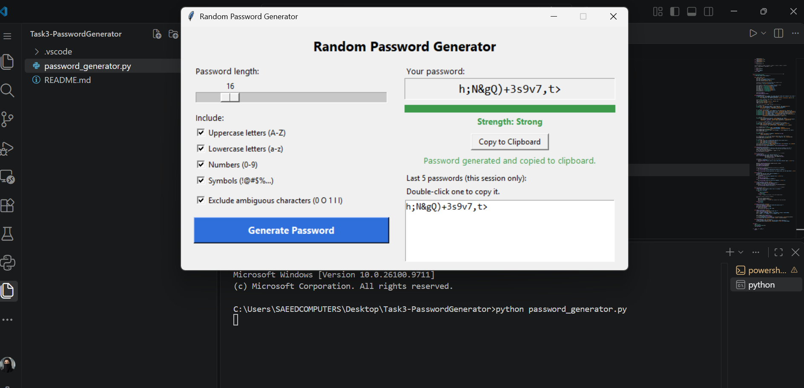
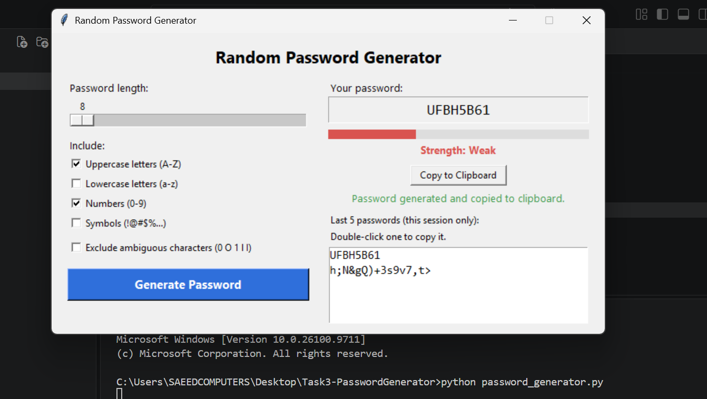
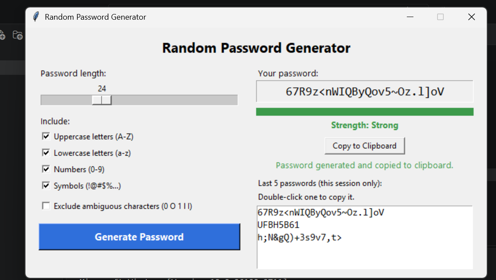
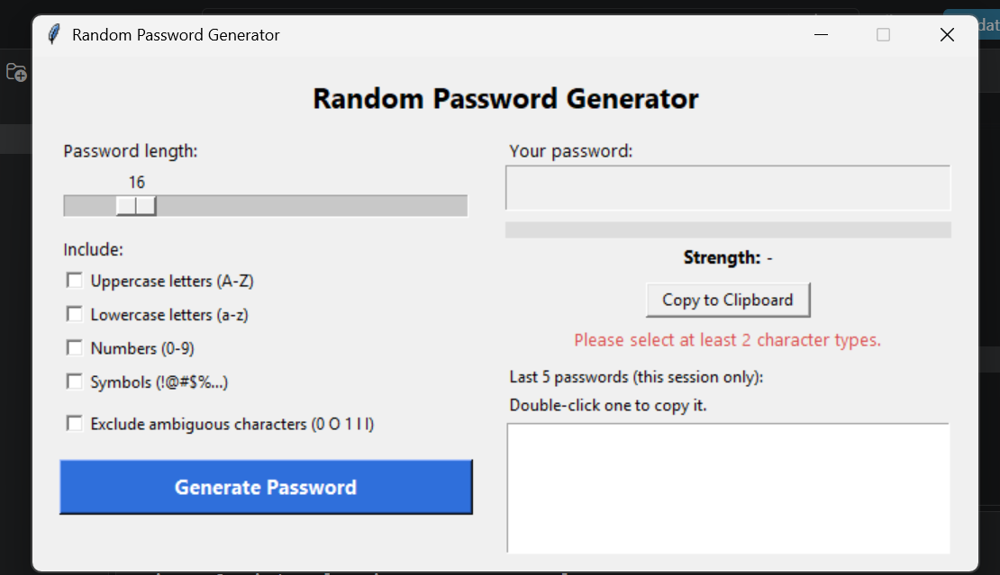
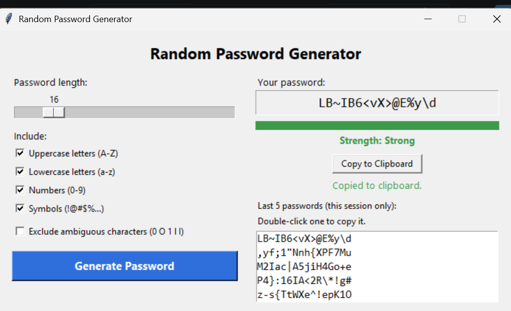

# Random Password Generator (Advanced Tier)

**Name:** Rabia Azam
**Internship:** Oasis Infobyte (OIBSIP)
**Track:** Python Programming
**Task:** Task 3 - Random Password Generator (Advanced)

## About
A desktop application (tkinter GUI) that generates strong, cryptographically secure random passwords. The user controls the length and the character types, sees a strength rating, and can copy the password with one click.

## Features
- GUI window built with **tkinter**: slider for length, checkboxes for character types
- Length range 8 to 64 characters
- At least 2 character types must be selected (error shown inside the window)
- Uses the **`secrets`** module for cryptographically secure generation (not `random`)
- **Security rule:** every generated password contains at least one character from each selected type
- **Strength indicator:** colour bar and label (Weak / Medium / Strong) based on length and character variety
- **Copy to clipboard:** the password is copied automatically on generation (via `pyperclip`), and there is also a Copy button
- **Exclude ambiguous characters** option (`0`, `O`, `1`, `l`, `I`)
- **History:** the last 5 passwords of the current session are shown; double-click one to copy it
- Errors and confirmations are shown inside the GUI, not in the terminal

## Tech Stack
Python 3, tkinter (included with Python), secrets, pyperclip

## Installation and Run
```cmd
pip install pyperclip
python password_generator.py
```
If `pyperclip` is not installed, the app still works and uses tkinter's built-in clipboard instead.

## How the Strength Rating Works
Points are added for length (10+, 14+, 20+ characters) and for character variety (3 or 4 types). The total gives Weak, Medium or Strong.

## Privacy and Security Notes
- Passwords are generated locally on your computer. Nothing is sent over the internet.
- The history lives only in memory and is **never saved to a file**. It disappears when the window is closed.
- Passwords are placed on the system clipboard when copied. Clipboard contents can be read by other programs, so paste the password where you need it and copy something else afterwards.

## Files
- `password_generator.py`: Advanced version (main submission)
- `README.md`: this file
- `screenshots/`: screenshots of the application

## Screenshots

### Main window


### Weak strength (short password, few character types)


### Strong strength (long password, all character types)


### Error handling (no character type selected)


### History and copy to clipboard



## Demo Video
[Watch the demo on LinkedIn]
https://www.linkedin.com/feed/update/urn:li:activity:7521890537256214528/