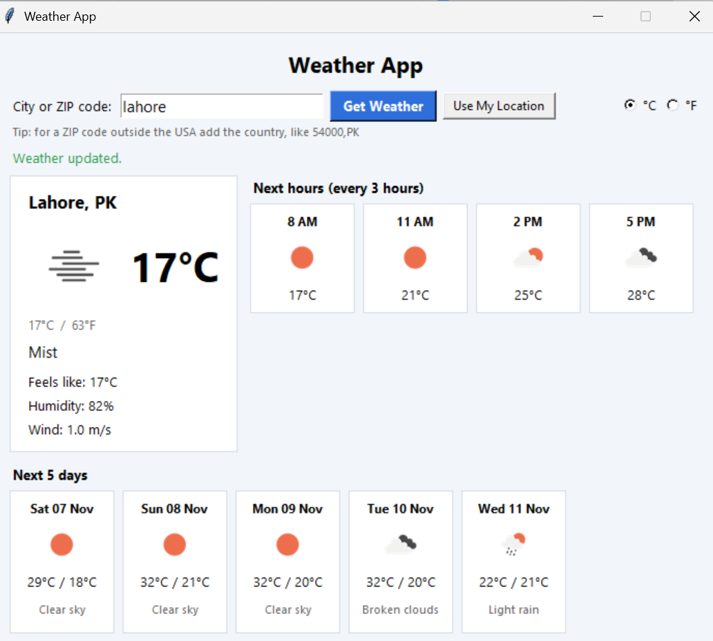
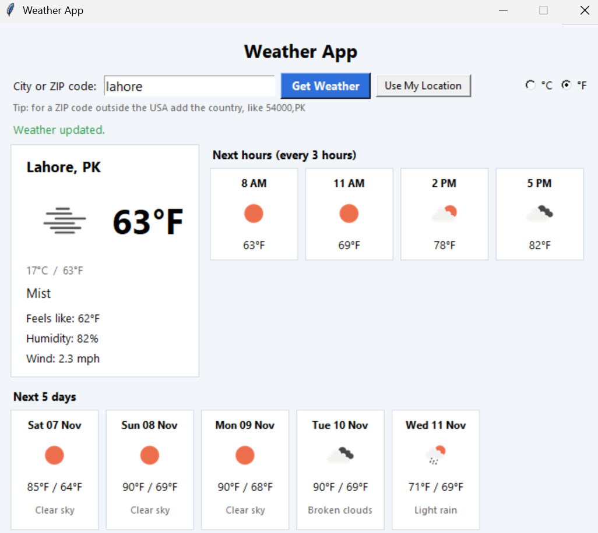
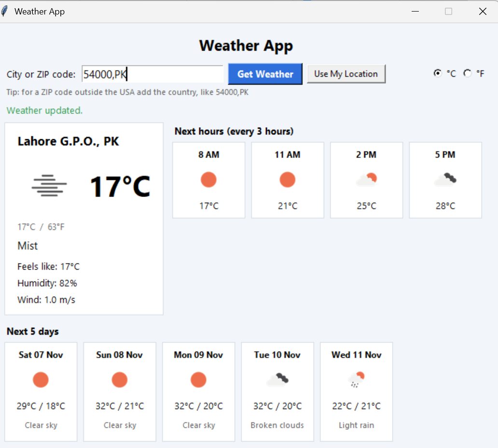
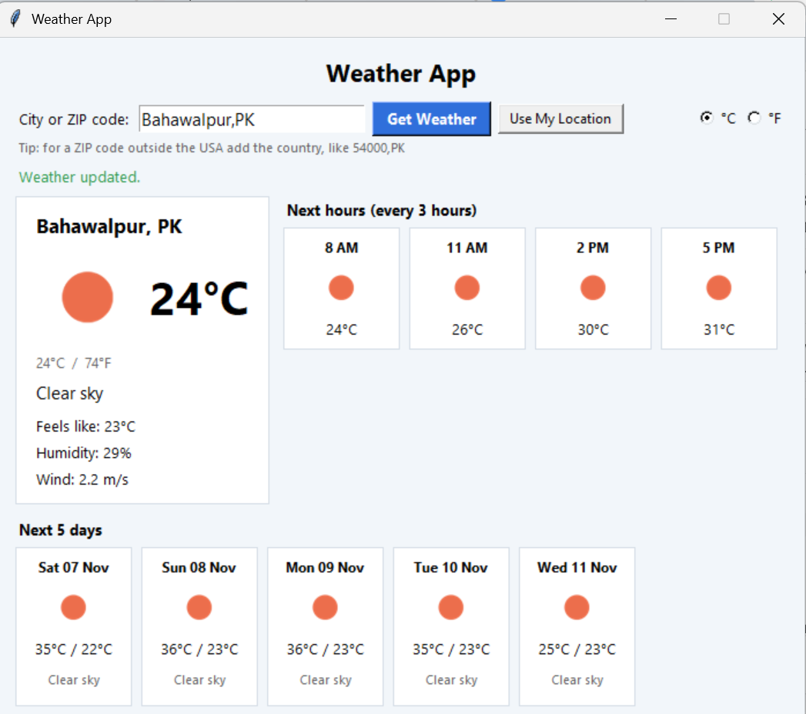

# Weather App (Advanced Tier)

**Name:** Rabia Azam
**Internship:** Oasis Infobyte (OIBSIP)
**Track:** Python Programming
**Task:** Task 4 - Basic Weather App (Advanced)

## About
A desktop application (tkinter GUI) that shows the current weather and a forecast for any city or ZIP code in the world. It uses real data from the OpenWeatherMap API.

## Why This Project?
Weather decides what we wear, when we travel and when we work outside. This app puts the important numbers in one small window: temperature, humidity, wind, and what the next hours and days will look like. It also shows how to use a real web API safely and how to keep a desktop window responsive while data loads.

## Features
- Search by **city name** (for example `Lahore`, `London,GB`) or **ZIP code** (for example `90210`, or `54000,PK`)
- **Current weather:** temperature, "feels like", humidity, wind speed, description and an icon
- **Celsius / Fahrenheit switch** that updates the whole window instantly, with no new internet request
- **Forecast:** next 12 hours (3-hour steps) and next 5 days (high, low and description)
- **Use My Location** button: finds your city from your IP address (ipinfo.io)
- **Background thread:** the window never freezes while the data loads
- **Error handling inside the window:** empty input, city not found, no internet, timeout, invalid API key, too many requests
- **API key stays private:** it is read from `config.json`, which is NOT uploaded to GitHub

## Tech Stack
Python 3, tkinter, requests, Pillow, OpenWeatherMap API, ipinfo.io

## Setup
1. Install the packages:
```cmd
pip install requests pillow
```
2. Create a free account at https://openweathermap.org and copy your API key (a new key can take up to a few hours to start working).
3. Copy `config.example.json` to `config.json` and put your key in it:
```json
{
    "api_key": "paste-your-key-here"
}
```
4. Run:
```cmd
python weather_app.py
```

## How to Use
1. Type a city or ZIP code and click **Get Weather** (or press Enter)
2. Or click **Use My Location**
3. Switch between **°C** and **°F** at the top right

## How It Works
1. `build_query()` checks the input and decides if it is a city or a ZIP code.
2. `WeatherClient` calls the `/weather` and `/forecast` endpoints, downloads the icons and turns every problem into a clear message (`WeatherError`).
3. `parse_current()` and `parse_forecast()` pick the needed values from the API answer and group the 3-hour steps into days.
4. `WeatherApp` builds the window. The internet work runs in a separate thread and sends its result back through a queue, which keeps tkinter safe and the window smooth.

## Privacy and Security Notes
- The API key is never written in the code and `config.json` is listed in `.gitignore`.
- "Use My Location" sends a request to ipinfo.io and gives only an approximate city. You can always type a city instead.

## Files
- `weather_app.py`: the application (main submission)
- `config.example.json`: template for your API key
- `README.md`: this file
- `screenshots/`: screenshots of the application

## Screenshots

### Main window (current weather and forecast)


### Fahrenheit mode


### Another city or ZIP code


### Use My Location


### Error handling (city not found)
.png)

## Demo Video
linkedin link :https://www.linkedin.com/feed/update/urn:li:activity:7524307519960317952/