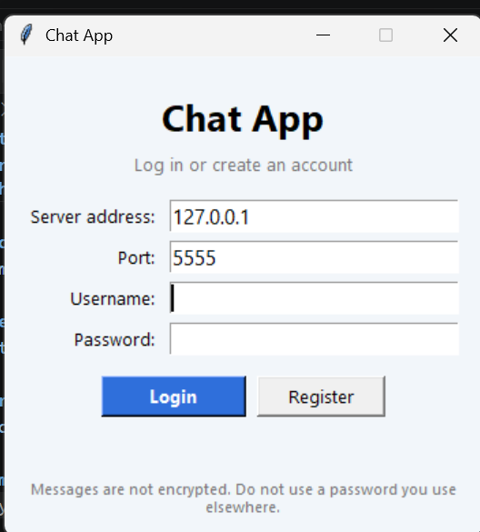
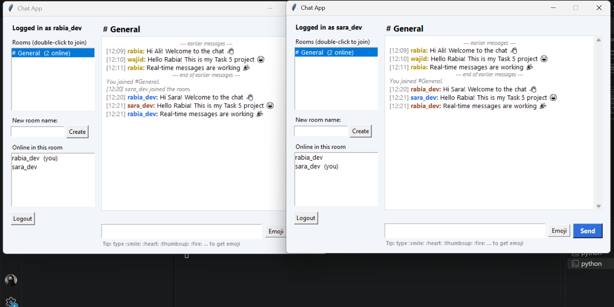
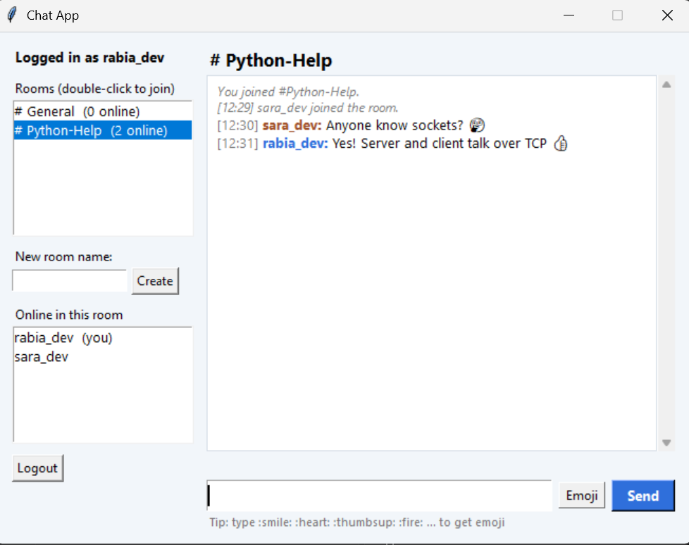
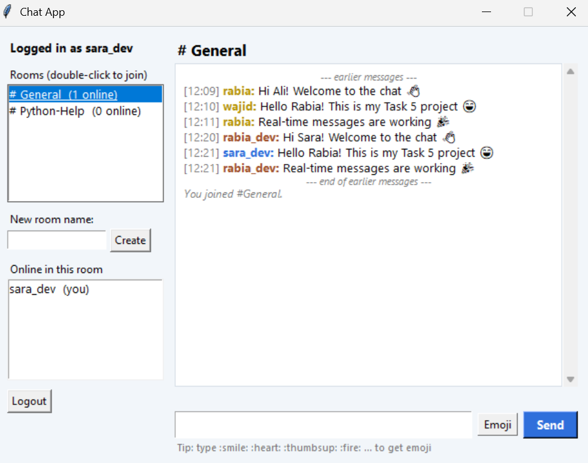
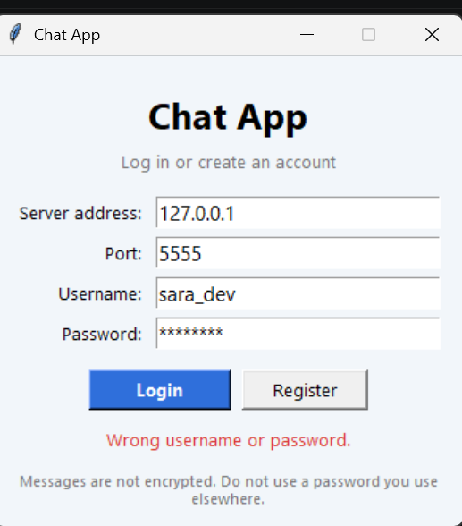

# Chat Application (Advanced Tier)

**Name:** Rabia Azam
**Internship:** Oasis Infobyte (OIBSIP)
**Track:** Python Programming
**Task:** Task 5 - Chat Application (Advanced)

## About
A real-time chat application built with Python sockets. A **server** (`server.py`) handles many users at the same time, and each user opens a **client** window (`client.py`, built with tkinter). Users create an account, log in, join chat rooms and talk in real time. Messages are saved in SQLite, so the history of a room is there when you come back.

## Why This Project?
Almost every app today needs some kind of live messaging. Building a chat from sockets shows what happens behind the scenes: how a server keeps many connections open, how a message travels from one user to everyone in a room, and how accounts and history are stored.

## Features
All Beginner features are included:
- Server that listens for incoming client connections (many at the same time, one thread per client)
- Client that connects to the server (both run on one machine with `localhost`)
- Real-time two-way messages between connected users
- Timestamp on every message, for example `[14:35] Alice: Hello`
- Disconnection handling: the room is told when someone leaves or disconnects

Advanced features:
- **GUI** built with tkinter: login screen and chat screen
- **Registration and login** with username and password, stored in SQLite (passwords are hashed)
- **Multiple rooms:** create a room or double-click one to join it. The room list shows how many users are online in each room
- **Message history:** the last 50 messages of a room are loaded when you join
- **Notifications:** when a message arrives while the window is not in focus, the window title shows a counter like `(2) New message`, the app beeps, and the taskbar icon flashes (Windows)
- **Emoji shortcodes:** `:smile:` becomes a smiley, `:heart:` a heart, and so on (36 emoji, plus an Emoji menu)
- **Basic protection:** username and room name rules, a message length limit (500 characters), a flood limit (more than 10 messages in 5 seconds is blocked), and an oversized-data check
- **Security transparency:** see the section below

## Tech Stack
Python 3, `socket`, `threading`, `sqlite3`, `tkinter`, `hashlib` (PBKDF2). No extra packages to install.

## Installation and Run
No `pip install` is needed.

1. Open a terminal and start the server:
```cmd
python server.py
```
2. Open a **second** terminal and start a client:
```cmd
python client.py
```
3. Open a **third** terminal and start another client (for the second user).
4. In each client window click **Register** (first time) or **Login**, then chat.

Server options (optional):
```cmd
python server.py --port 5556
python server.py --host 0.0.0.0
```
`--host 0.0.0.0` lets other computers on the same network connect. The default (`127.0.0.1`) only accepts connections from your own computer.

## How to Use
1. Register with a username (3-20 letters, numbers or `_`) and a password (6-64 characters)
2. You start in the `General` room
3. Type a message and press Enter
4. Create a new room with the **New room name** box, or double-click a room in the list to join it
5. Use the **Emoji** button, or type shortcodes such as `:smile:`, `:fire:`, `:thumbsup:`

## How It Works
- Client and server talk with small JSON messages, one per line, over a TCP socket.
- `ChatServer` accepts each connection and starts a thread for it. `handle_line()` sends every request to the right function (register, login, join room, create room, message).
- `ChatDatabase` keeps three SQLite tables: `users`, `rooms` and `messages`. Queries use `?` placeholders, so user input cannot damage the database.
- When a message arrives, the server saves it and sends it to every client in the same room.
- In the client, a background thread reads from the socket and puts the messages in a queue. The window reads the queue every 100 ms. This keeps the window smooth and is safe for tkinter.

## Security and Privacy (what is stored and what is NOT encrypted)
**How data is stored** (in the file `chat_data.db`, on the computer that runs `server.py`):
- **Passwords:** never stored as plain text. Each password is stored as a salted hash (PBKDF2-HMAC-SHA256, 200,000 rounds, a random salt per user).
- **Messages:** stored as **plain text**, together with the room, the username and the time. Anyone who can open `chat_data.db` (for example the person running the server) can read all messages.
- **Rooms:** only the room names are stored.

**What is NOT encrypted or protected:**
- The connection between client and server is plain TCP. It is **not encrypted**. On a shared network, other people could read the messages and the password while they travel. The password is hashed only after it reaches the server.
- This is **not end-to-end encrypted**. The server sees every message.
- Rooms are **open**: any logged-in user can join any room. There are no private rooms.
- There is no password reset, no email check, and no "remember me" token.
- The registration message "That username is already taken" shows which names exist.

**Safe way to use it:** run it on `localhost` or on a trusted network, and do not use a password you use anywhere else. For real use, the connection should be wrapped with TLS and messages should be encrypted end to end.

## Files
- `server.py`: the backend (sockets, database, rooms)
- `client.py`: the GUI client (tkinter)
- `README.md`: this file
- `screenshots/`: screenshots of the application

`chat_data.db` is created automatically when the server starts. It is not uploaded to GitHub because it contains user data.

## Screenshots

### Login and register screen


### Chat between two users


### Rooms (new room created)


### Message history and emoji


### Error handling (wrong password)


## Demo Video
 LinkedIn post link :
 https://www.linkedin.com/feed/update/urn:li:activity:7525526154125078528/